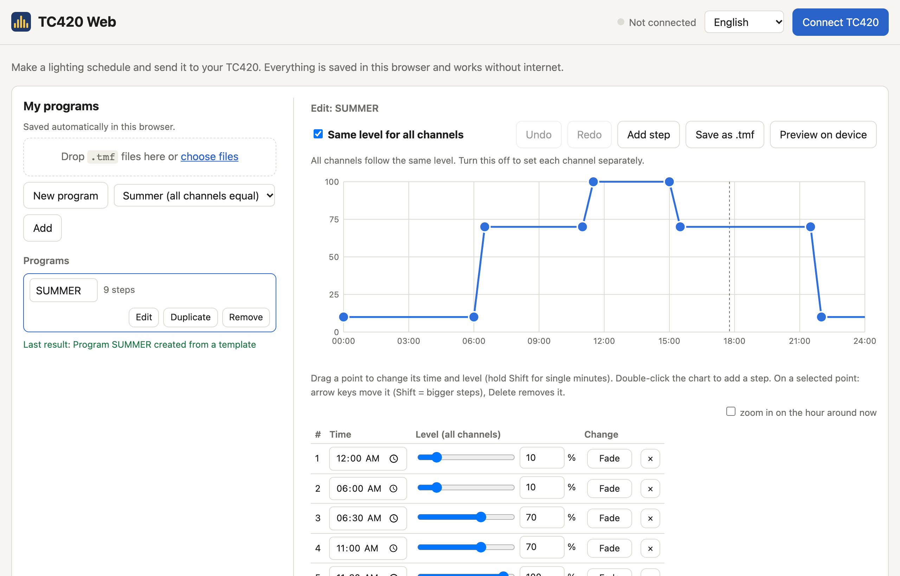

# TC420 Web

Edit the lighting schedules of your **TC420 LED time controller** in the browser and send them to the
controller over USB. No PLed, no Windows, nothing to install, and after the first visit no internet either.

**[Open TC420 Web →](https://topscoder.github.io/tc420-web/)**

Works in English, Nederlands and Deutsch (it follows your browser; change it at the top right).

## What you need

- **Chrome or Edge** (or another Chromium-based browser such as Opera) on **Windows, macOS, Linux or
  ChromeOS**.
- The **USB cable** of your TC420.
- Safari, Firefox, iPhone, iPad and Android cannot connect to USB devices. You can still make, import and
  export programs there, and send them later from a computer with Chrome or Edge.
- Windows and macOS need no drivers. Linux needs a [one-time setup](docs/help/linux.md).

## Use it without internet

Open TC420 Web once while you are online. Under **Settings → Use without internet** it then says
*Ready*, and the app keeps working without internet in that browser, for example next to an aquarium or
terrarium. You can also **install it as an app**: in Chrome or Edge use the install icon in the address bar, or
the browser menu → *Install TC420 Web*. It then opens from your desktop or dock like any other program.

When a new version is published, the app tells you and reloads only when you click *Reload*. Your programs
are kept.

## Quick start

1. **Make a program.** Start from a template (day and night, sunrise and sunset, winter, summer, or the
   examples that came with PLed), import `.tmf` files from PLed, or start empty.
2. **Edit it.** Drag the points in the chart or change the times and levels in the table. *Same level for all
   channels* keeps things simple; turn it off to set each of the five channels separately. Each step can
   **fade** gradually or **switch instantly**.
3. **Connect the TC420.** Plug in the USB cable and click **Connect TC420**. The first time, your browser asks
   which device to use: choose *Time Controller*. Next time it connects by itself. The app offers to set the
   controller's clock to your computer's time.
4. **Preview it (optional).** *Preview on device* plays the program on the real lights, a whole day in 1, 2 or
   5 minutes, or lets you set levels by hand. Nothing is stored; when you stop, the controller goes back to
   its normal program.
5. **Send it.** Click **Send … to TC420**. The controller is cleared, gets this one program and the right time,
   and runs it straight away, without pressing any buttons on the controller. To switch to another program
   later (say from winter to summer), select it and send it.
6. **Export a backup.** The controller cannot be read back, so your programs only live in this browser. Use
   *Export backup* now and then (also under *Settings*).

Can you reach the buttons on your TC420 and want several programs on it? Turn on **Settings → Multiple
programs on the controller**; all programs are then sent in list order.

## Questions and problems

**The controller is not found.** Check the cable, then click *Connect TC420* again and choose *Time
Controller*. Close other tabs or programs that might be using it (such as PLed).

**"Linux blocked access to the controller."** Linux needs a rule that allows you to use the TC420. The app
shows the commands (*Linux setup*); see also [docs/help/linux.md](docs/help/linux.md).

**Can I read the program that is on my controller now?** No. The TC420 cannot send its programs back, so keep
your programs in the app and export a backup.

**The time on the controller is wrong.** Connect, open the menu under the green *TC420 connected* button and
choose *Set clock*. Sending a program also sets the clock unless you untick it.

**Does it work with my PLed files?** Yes: import `.tmf` files, and *Save as .tmf* to use a program in PLed
again.

**Something else is wrong.** Open *Advanced*, save the log as a file, and
[open an issue](https://github.com/topscoder/tc420-web/issues/new) describing what you did and what happened,
with the file attached. The log contains the messages exchanged with the controller, your program names and
your browser version.

## Privacy

Everything happens in your browser. Your programs and the log are stored only on your device. Nothing is sent
anywhere, and there are no trackers or analytics. The site itself is hosted on GitHub
Pages.

## Disclaimer

TC420 Web is an independent project. It is not made, endorsed or supported by the manufacturer of the TC420;
"TC420" is only used to say which controller it works with. It is provided as is, without warranty: use it at
your own risk.

## License and credits

[MIT license](LICENSE), © 2026 TC420 Web contributors. What changed in each version: [CHANGELOG.md](CHANGELOG.md).

- The USB protocol was worked out by reverse engineering the vendor's PLed 1.1 software and checked against
  the open-source library [wallneradam/tc420](https://github.com/wallneradam/tc420) (GPL-3). That library was
  used only as a reference; no code was copied.
- The templates AFRIKA, AMAZONE and THAILAND are the example programs that came with PLed.

## For developers

TC420 Web is a static web app in plain JavaScript modules, with no runtime dependencies. See the
[developer notes](docs/development.md) to run it locally and run the tests, and the
[documentation](docs/README.md) for the USB protocol, the `.tmf` file format, the analysis of PLed and the
hardware test logs. Contributions are welcome through issues and pull requests.
