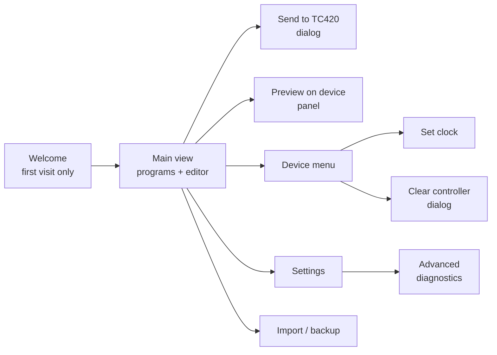
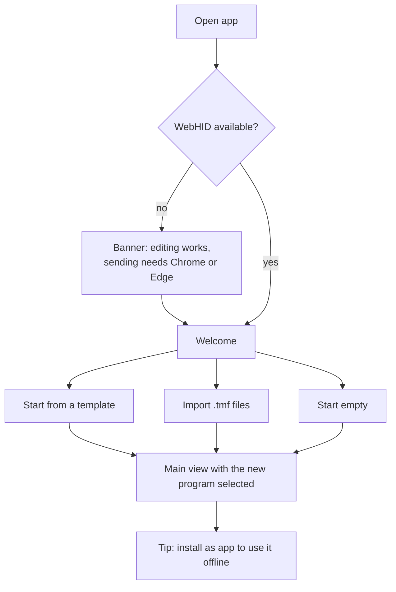

# TC420 Web – end-user UX design

Status: proposal for issue #1. Wireframes: [`wireframes.html`](wireframes.html) (open in a browser).

TC420 Web lets owners of a TC420 LED controller create lighting schedules and send them to the controller over USB. It runs in the browser, works offline after the first visit and needs no other software. This document defines the screens, the main flows and the wording rules that the other v1.0 issues build on.

## 1. Who it is for

| User | Situation | What they want |
| --- | --- | --- |
| Aquarium or terrarium owner | Has a TC420, a Mac or Linux laptop, and no Windows PC | Change the day/night schedule without PLed |
| Former PLed user | Has `.tmf` files from PLed | Open them, adjust them and send them to the controller |
| First-time user | New TC420, no files | Get a sensible schedule onto the controller in a few minutes |

Assumptions: users are not technical, sit next to the controller with a USB cable, often have no internet there, and use Chrome or Edge on a laptop.

## 2. Design principles

1. **Edit first, connect later.** All editing works without a device or WebHID. The controller is only needed to send, preview or set the clock.
2. **The app is the source of truth.** The TC420 cannot be read back, so the app saves everything automatically and nudges users to export a backup.
3. **One program on the controller by default.** Many controllers are built in where nobody can reach their buttons, so users cannot switch programs on the device. By default *Send to TC420* replaces everything on the controller with the one selected program, so there is no doubt which program runs. Users who can switch programs on the device turn on *Multiple programs on the controller* in Settings.
4. **No protocol words.** The main UI never shows packets, command codes, banks, WebHID or report IDs. Those live in *Advanced*.
5. **Safe by default.** Anything that overwrites or clears the controller needs a confirmation that says exactly what will change.
6. **One clear primary action per screen.** In the main view that is *Send to TC420*.
7. **Same words everywhere.** Use the glossary in section 7 in all three languages.

## 3. App structure

### Header (always visible)

`TC420 Web` · device status chip · language switcher (EN / NL / DE) · menu (Settings, Help, Advanced).

The device status chip is the single entry point for the device:

| State | Chip | Click |
| --- | --- | --- |
| Not connected | `○ Connect TC420` | opens the browser's device chooser (with an explanation tooltip first time) |
| Connected | `● TC420 connected` | opens the device menu: Set clock · Preview… · Clear controller… · Disconnect |
| Busy | `◌ Sending… 12/42` | disabled |
| Browser not supported | `⚠ USB not available` | explains which browsers work |

### Main view

Two panes.

- **My programs (left).** All programs saved in this browser (own programs, imported `.tmf` files, programs made from templates). Each card shows the name (max. 8 characters, as on the controller display), a mini chart and the number of steps. The program that was last sent carries an **On controller** badge. Actions: *New program*, *Import*. Pinned at the bottom: the primary button **Send to TC420**, which sends the selected program, with a hint like "On controller: WINTER · sent 22 Oct 09:28" or "WINTER changed since it was sent". Switching between, for example, winter and summer is done by selecting the other program and sending it.
- **Multiple programs mode** (Settings, off by default, for controllers whose buttons the user can reach): the list shows slot numbers (Program 1, 2, …) in controller order, can be reordered by dragging, and *Send to TC420* sends all programs in that order.
- **Editor (right)** for the selected program:
  - Name field with a live character counter (8).
  - Timeline chart from 00:00 to 24:00, one coloured line per channel, a "now" marker, draggable points.
  - *Same level for all channels* toggle (on by default for new programs).
  - Step list: time, level per channel (slider + number), per-channel *Fade* / *Switch instantly*, delete. *Add step* inserts a step at the selected time.
  - Toolbar: *Preview on device*, *Duplicate*, *Export .tmf*, *Delete*.
  - Inline validation messages ("Add at least 2 steps", "Two steps at 07:00", "Maximum 50 steps").

On narrow screens (< 900 px) the panes stack: the programs list becomes a dropdown above the editor, and *Send to TC420* moves to a sticky bottom bar.

### Dialogs and panels

- **Send to TC420** (dialog): "The controller will run **WINTER**. Everything else on the controller is removed.", the note "The controller cannot be read back. Your programs stay saved in this browser; export a backup to be safe.", a checkbox *Also set the clock* (checked), and the buttons *Cancel* / *Send*. Technically the app clears the controller, writes the program to slot 1 and sets the clock. In multiple programs mode the dialog lists "Program 1 ← WINTER, Program 2 ← ZOMER" instead. During sending: a progress bar. Afterwards: success with *Export backup* as a secondary action, or a failure message with *Try again*.
- **Preview on device** (side panel): play the program fast-forwarded (1 day in 1, 2 or 5 minutes), play/pause/stop, a time scrubber, and a *Manual* tab with sliders per channel. The editor chart shows the playback cursor. A note says that nothing is saved and the controller returns to its normal program afterwards.
- **Clear controller** (dialog): "Remove all programs from the controller?" Typed confirmation is not needed; the danger button is labelled *Remove all programs*.
- **Settings**: language, channel names and colours (e.g. "White", "Blue", "Moonlight"), *Export backup* / *Restore backup*, *Delete all programs in this browser*, about and version, *Install as app* instructions.
- **Advanced** (collapsed section in Settings): communication log with export, raw packet sender, simulator on/off. This is the current test bench without the T1–T7 layout.

## 4. Main flows

### 4.1 First visit

Templates: *Simple day and night*, *Sunrise, noon and sunset*, *Winter* and *Summer* (all channels equal), and the three examples that came with PLed (*AFRIKA*, *AMAZONE*, *THAILAND*). The PLed examples are bundled as they are; AMAZONE's out-of-order last step is sorted by time when the template is opened.

### 4.2 Make a schedule and send it

1. Select or create a program; give it a name.
2. Drag points or add steps; leave *Same level for all channels* on for a simple setup.
3. Optional: *Preview on device* to see it on the real lights.
4. Click *Send to TC420*. If not connected, the browser device chooser opens first.
5. Confirm in the dialog: "The controller will run WINTER" (clock is set too by default).
6. The app clears the controller, writes the program and sets the clock.
7. Success screen: "WINTER is now running on the controller", with *Export backup*.

Changing season later: select *ZOMER* and send it; the controller then runs only ZOMER.

### 4.3 Connect and set the clock

1. Click `○ Connect TC420`. The first time, a short explanation appears: "Your browser will ask which device to use. Choose **Time Controller**."
2. After connecting, a toast asks: "The controller clock may be wrong. Set it to this computer's time (10:42)?" → *Set clock* / *Not now*.
3. The app remembers the permission and reconnects automatically next time.

### 4.4 Errors

| Situation | Message (EN) | Actions |
| --- | --- | --- |
| No device chosen | "No controller selected." | *Try again* |
| Device unplugged during sending | "The connection was lost while sending. The controller may contain an incomplete program. Reconnect and send again." | *Reconnect* |
| No reply | "The controller did not respond. Check the cable and that no other app or tab is using it." | *Try again* · *Open Advanced log* |
| Permission denied (Linux) | "Your computer blocked access to the controller. See the Linux setup guide." | *Open guide* |
| Browser not supported | "Sending needs Chrome or Edge on a computer. You can still edit and export programs." | *Learn more* |

## 5. Offline and storage

- After the first visit everything works offline, including the device features (PWA, issue #8).
- Programs, channel names, language and the last-sent state are saved automatically in the browser (issue #4).
- The *Changes not sent yet* hint compares the programs with what was last sent from this browser.

## 6. Wording rules

- Address the user as "you"; short sentences; verbs on buttons (*Send to TC420*, not *Upload*).
- Say **controller** in running text and **TC420** on buttons and in the device chip.
- Times in 24-hour format in NL and DE and in the user's locale format in EN; levels in %.
- Program names: strictly max. 8 characters from `A–Z`, `0–9`, space and `-`; letters are converted to capitals while typing; other characters cannot be entered. Explain why: "shown on the controller display".
- Never show hex, command codes, "bank", "WebHID", "report", "packet" outside *Advanced*.

## 7. Glossary

| Concept | English | Nederlands | Deutsch |
| --- | --- | --- | --- |
| Stored schedule on the device | program | programma | Programm |
| Position on the device | Program 1, 2, … | Programma 1, 2, … | Programm 1, 2, … |
| Point in time with levels | step | stap | Schritt |
| Output | channel | kanaal | Kanal |
| Brightness | level (%) | niveau (%) | Helligkeit (%) |
| Gradual change | fade | geleidelijk | überblenden |
| Immediate change | switch instantly | direct schakelen | sofort schalten |
| Write to device | Send to TC420 | Naar TC420 sturen | An TC420 senden |
| Online play | Preview on device | Voorbeeld op apparaat | Vorschau am Gerät |
| Set device time | Set clock | Klok gelijkzetten | Uhr stellen |
| Remove all from device | Clear controller | Controller wissen | Controller löschen |
| Export everything | backup | back-up | Sicherung |

The NL and DE terms are proposals for the native-speaker review (issue #17).

## 8. Mapping to issues

| Area | Issue |
| --- | --- |
| Language switcher, glossary | #2, #17 |
| Editor, templates | #3 |
| Programs list, *On controller* badge, saving, import/export, backup, multiple programs setting | #4 |
| Device chip, connect, set clock, send, clear, errors | #5 |
| Preview panel | #6 |
| Advanced section | #7 |
| Offline, install hint | #8 |
| Unsupported browser banner, Linux guide | #9 |
| Visual design, accessibility | #10 |

## 9. Decisions and open questions

Decided (24 Oct 2026):

- Default: one program on the controller. *Send to TC420* clears the controller and writes the selected program to slot 1. Sending all programs in order is available as *Multiple programs on the controller* in Settings.
- Program names are strictly limited to 8 characters (`A–Z`, `0–9`, space, `-`).
- The PLed example programs are bundled as templates.

To verify on hardware (issue #11):

- After *clear controller* + writing slot 1, does the controller run that program without anyone pressing buttons, also after a power cycle?
- Which program runs after sending several programs, if nobody selects one on the device?
